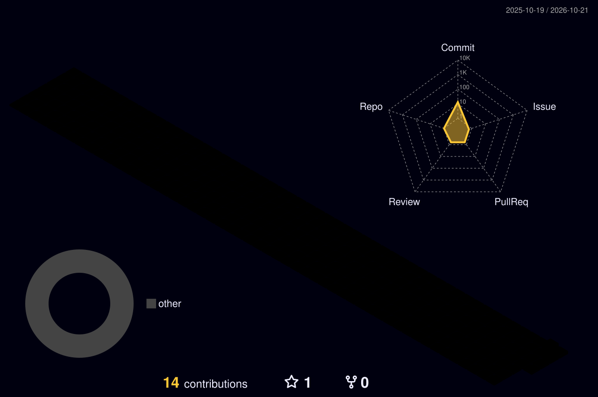

<!-- NIDHIN | AI FREELANCER | GitHub: diviljocker -->

 

<strong>AI Freelancer • AI Agent Builder • Vibe Coder • Prompt Engineer</strong>

Turning ideas into intelligent solutions with AI, automation, and code.

 

---

## 🧠 About Me

Hey, I'm <strong>Nidhin</strong> 👋

I'm an AI-focused freelancer passionate about building useful digital products, intelligent agents, and creative solutions.

- 🤖 <strong>AI Agent Building</strong> — creating AI-powered workflows and assistants.
- ⚡ <strong>Vibe Coding</strong> — turning ideas into working applications with AI-assisted coding.
- 🧠 <strong>Prompt Engineering</strong> — designing effective prompts for better AI outputs.
- 🚀 <strong>AI Freelancing</strong> — exploring smart solutions for real-world business problems.
- 🛠️ <strong>Automation</strong> — reducing repetitive work using AI.
- 🌱 <strong>Currently Learning</strong> — AI tools, agentic workflows, and modern development.

> My goal: Build smarter, automate better, and turn creative ideas into reality.

---

## 🛠️ My AI Toolkit

  

---

## 🚀 What I'm Building

<table>
<tr>
<td width="50%" valign="top">

### 🤖 AI Agents

Building intelligent assistants that can use tools, complete tasks, and automate workflows.

</td>
<td width="50%" valign="top">

### ⚡ Vibe Coding

Turning ideas into websites, applications, and useful digital tools with AI-assisted coding.

</td>
</tr>
<tr>
<td width="50%" valign="top">

### 🧠 Prompt Engineering

Creating structured prompts and reusable workflows for better AI results.

</td>
<td width="50%" valign="top">

### 💼 AI Freelancing

Exploring AI-powered content creation, business automation, and custom digital solutions.

</td>
</tr>
</table>

---

## 📊 GitHub Analytics

  

---

## 🌌 My 3D GitHub Universe

---

## 💡 My Philosophy

### Think with AI. Build with code. Create without limits.

> "The future belongs to people who can turn ideas into action."

 

<strong>Let's build something intelligent. 🤖</strong>

 

<a href="https://github.com/diviljocker">Explore My Projects</a>

  

